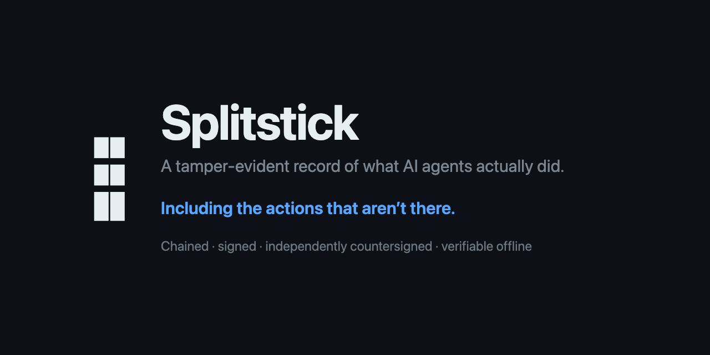

# Splitstick

**Agent actions you can prove — including the ones that aren't there.**

A tamper-evident record of what AI agents actually did: chained, signed, independently
countersigned, and verifiable offline by anyone holding the bytes and a public key.

> **Status: 0.9.0 — open for technical review.**
>
> The 1.0 backlog is complete, 193 of 193, and the release gate would pass a `v1.0.0`
> tag. It ships as 0.9.0 because so far the only person who has read the evidence is the
> one who produced it. The design, the verifier, the threat model and the attack suite are
> what this release is putting up for review.
>
> Two things to know before you start. **One attack is deliberately left open:** an operator
> who patches their own collector so that one action is never recorded at all. The patched
> build needs to forge nothing — it reports the published digest by reporting it, because
> nothing measures the process that does the reporting. The attack suite runs it on every
> build and prints `NOT CLOSED`, and the verifier tells every reader they are trusting the
> operator on that point. It is explained in full further down.
>
> And nobody outside this project has operated any of this yet, so the likely rough edges
> are a witness configuration this author never tried and an onboarding step that works by
> accident of this repository.
> [The 0.9.0 notes](docs/splitstick-0.9.0-release-notes.md) open with the rest.

## Why this exists

Agent runtimes ship run journals and verifiers. They catch corrupted logs, mis-stitched
resumes and buggy context rewrites — real problems. What they cannot catch is the operator,
who holds the only key and writes the only copy.

We measured that instead of asserting it. Against a genuine run record from a widely used
runtime, with one EUR 2,000,000 transfer in it, most of our alterations passed the runtime's
own verifier — including changing the amount to EUR 25 and deleting the transfer entirely.

[`redteam/`](redteam/) reproduces that in two commands. It is also the acceptance harness:
each milestone flips an attack class from `undetected` to `detected` against *our* verifier,
and the suite exits non-zero whenever an observation changes in either direction.

### There is a date on it

The EU AI Act requires a high-risk AI system to allow the automatic recording of events over
its lifetime — Article 12, record-keeping. The Digital Omnibus on AI, Regulation (EU)
2026/1744, in force since 27 July 2026, moved that duty to **2 December 2027** for the
standalone high-risk systems in Annex III, and to 2 August 2028 for AI built into products
already regulated under Annex I — a little over a year from this 0.9.0 release.

The kind of record Article 12 asks for is tamper-evident: altering it afterwards leaves a
trace somebody else can find. That is a property of how a record is made and held, which
makes it an engineering problem, and engineering problems with dates on them are worth
starting early.

Splitstick produces records of that kind. Whether you conform is a separate question and
this project has no part in answering it — conformity is assessed by a body, against a
system, and no vendor can assert it on your behalf. See [Not legal advice](#not-legal-advice).

## Map

| Path | What |
|---|---|
| [`redteam/`](redteam/) | The tamper suite. Reproducible, runs offline, no API key. |
| [`docs/`](docs/) | [0.9.0 release notes](docs/splitstick-0.9.0-release-notes.md) — **start here**, it opens with the limits · [1.0 notes](docs/splitstick-1.0-release-notes.md) — the full claim set and the figures table · [threat model](docs/threat-model.md) · [self-hosted witness](docs/self-hosted-witness.md) — the deployment guide · [witness outages](docs/witness-outages.md) · [restore drill](docs/witness-restore-drill.md) · [evidence](docs/evidence/) — committed results a claim can be checked against |
| [`design/`](design/) | One spec per design element — [index and traceability](requirements/DESIGN.md) |
| [`requirements/`](requirements/) | [Backlog](requirements/MATRIX.md), [delivery plan](requirements/PLAN.md) and [design traceability](requirements/DESIGN.md) — gated by attack class. Counts live in the generated matrices, never in prose. |
| [`packages/`](packages/) | Shipped code, 11 packages: [`core`](packages/core) (record, canonical encoding, leaf, chain, tree, signer, store), [`collect-oma`](packages/collect-oma) (OMA journal and approval store), [`verify`](packages/verify) (the verifier and its CLI), [`mcp-proxy`](packages/mcp-proxy) (capture at the MCP seam), [`witnesses`](packages/witnesses) (the witness-set builder), and one package per witness type — [`witness-tlog`](packages/witness-tlog) (transparency-dev/witness), [`witness-tsa`](packages/witness-tsa) (RFC 3161), [`witness-ots`](packages/witness-ots), [`witness-rekor`](packages/witness-rekor), [`witness-self`](packages/witness-self) (the operator-hosted stateful witness), plus [`signer-aws-kms`](packages/signer-aws-kms) |
| [`spec/vectors/`](spec/vectors/) | Conformance vectors — [RFC 8785](spec/vectors/jcs.json), [RFC 6962](spec/vectors/merkle.json), [C2SP note key ids](spec/vectors/note.json) |
| [`bench/`](bench/) | The performance budgets, measured and committed, with [committed results](bench/results/) the release notes cite by field |

## Install

```bash
npm install @splitstick/core @splitstick/collect-oma                               # record
npm install @splitstick/verify                                                     # verify, coverage, disclose
npm install @splitstick/witnesses @splitstick/witness-tsa @splitstick/witness-ots  # anchor
```

These are the published specifiers, and so are the imports in the next section. `npm run
smoke` packs every tarball on each release, installs them into a temporary project with no
workspace and no link back to this repository, and exercises 52 entry points and all four
executables — so what a consumer resolves is what is tested, rather than what the workspace
happens to resolve.

The registry copies appear when the release workflow runs. Until `v0.9.0` is tagged, work
from a clone: `npm install` at the root, then the npm scripts at the end of the next
section.

## Getting started

Five entry points. Everything below is executed verbatim by the CLI contract test
(`test/cli-contract.test.mjs`), so a flag that is renamed, dropped or invented here is a
failing test instead of a manual that lies.

**Record.** `collect-oma` is a library, not a command: it is the journal and approval-store
backend you hand to `@open-multi-agent/core` (tested against 1.21.x). Every action the agent
takes is appended, salted and chained as it happens.

```js
import { Store } from '@splitstick/core/store';
import { Collector } from '@splitstick/core/collector';
import { parseConfig } from '@splitstick/core/config';
import { generateDevSigner } from '@splitstick/core/signer-file';
import { SplitstickRunJournal } from '@splitstick/collect-oma';

const store = new Store('./evidence', 'host-1');
const collector = new Collector({
  store, config: parseConfig('version: 1\nstore: ./evidence\n', '.'),
  signer: await generateDevSigner('splitstick.dev/host-1'),
  collector: 'host-1', origin: 'splitstick.dev/host-1',
});
// `journal` is OMA's own, passed through: retention stays its job.
const journal = new SplitstickRunJournal({ collector });
```

For a third-party agent, sit in front of its MCP server instead and record the tool calls
as they cross the wire:

```bash
splitstick-mcp-proxy --upstream "node ./my-mcp-server.mjs" --out ./evidence
```

**Verify.** Offline — it opens files and does arithmetic. `--policy` is your acceptance
policy, not ours: whose countersignature you accept and what each one establishes. Two
readers with different policies get different, internally consistent answers from the same
evidence, which is the point. `$SPLITSTICK_KEY` is the operator identity you pin,
printed by the collector when it starts.

```bash
splitstick-verify ./evidence --collector host-1 --key "$SPLITSTICK_KEY" --policy ./policy.json
```

**Coverage.** What fraction of a window is anchored, and to what. The window is explicit
because a coverage number without one is a claim about nothing.

```bash
splitstick-coverage ./evidence --from 2026-10-01 --to 2026-10-31 --collector host-1 --policy ./policy.json
```

**Disclose.** One event, and nothing around it: not the run, not the neighbouring records. The
pack carries the inclusion proof and the signed root, so the recipient learns that this
event is in the tree without learning what else is. This needs a checkpoint some witness
has countersigned: an inclusion proof against a root only you signed establishes that you
are consistent with your own arithmetic, so Splitstick refuses to build the pack at all,
instead of handing it over with a caveat somebody has to notice.

```bash
splitstick-disclose ./evidence --event 3 --collector host-1 --out ./disclosure.json
```

The recipient verifies it with no store, no network and no credential:

```bash
splitstick-disclose --verify ./disclosure.json --key "$SPLITSTICK_KEY" --policy ./policy.json
```

Working from a clone, each command is also an npm script:
`npm run verify -- ./evidence --collector host-1`, and likewise `coverage`, `disclose` and
`mcp-proxy`.

**Exit codes**, because a pipeline reads these and an auditor reads the report. `0`, `1` and
`2` are always a *verdict* about evidence, and `3` is always a *refusal* of the invocation —
never a verdict. Nothing you typed wrong can come back as a finding about your evidence.

| | 0 | 1 | 2 | 3 | 4 |
|---|---|---|---|---|---|
| `verify` | ok | inconclusive | fail | refused | |
| `coverage` | complete | incomplete | inconclusive | refused | |
| `disclose --verify` | ok | fail | inconclusive | refused | |
| `mcp-proxy` | — | | | refused | upstream would not start |

## Working on it

```bash
npm install
npm test          # generate a fixture, then both tamper suites
npm run test:unit # the unit and conformance suites
npm run typecheck # JSDoc types over plain ESM, no build step
npm run bench     # the performance budgets, measured on this machine
npm run backlog   # revalidate requirements, regenerate the matrix and plan
npm run smoke     # pack the tarballs, install them into a clean project, run every bin
```

Node 20 or later. No build step: plain `.mjs` with JSDoc types checked by `tsc --checkJs`.
One runtime dependency in `core` (`yaml`, pinned exactly) and none in the verifier.

A note on the codes. The rest of this repository is full of labels like `FR-33`, `SEC-11`
and `NFR-01`: every sentence in the docs that makes a promise is traceable to a numbered
requirement, which is traceable to a test. [`requirements/MATRIX.md`](requirements/MATRIX.md)
resolves all of them. This page is written so you never need to look one up.

The backlog is data. `requirements/*.json` is the source of truth; `MATRIX.md` and
`PLAN.md` are generated. The validator rejects any requirement missing a release-notes
section behind it, and any release-1.0 requirement missing a milestone — a requirement
cannot exist without a promise.

## What is closed, and what still stands

Two tamper suites run on every change. The first alters a genuine OMA journal and asks
OMA's own `verifyRun()`; the second builds a real Splitstick store from that same journal
and asks `splitstick verify`. Same journal, same alterations, two verifiers — which makes
the comparison a measurement instead of a sales argument.

| The alteration | OMA's `verifyRun()` | Here, from files alone | Here, with a witness |
|---|---|---|---|
| Edit the tool result — EUR 2,000,000 to EUR 25 | passes | `LEAF_MISMATCH` | detected |
| Naive edit of a model-visible block | **caught** | `LEAF_MISMATCH` | detected |
| Consistent edit, content hash recomputed | passes | `TREE_MISMATCH` | detected |
| …and re-sign the checkpoint over the rewrite | — | undetected | `WITNESS_MISMATCH` |
| Truncate the tail | passes | `SIZE_REGRESSED` | detected |
| …and delete the checkpoints that contradict it | — | undetected | `TRUNCATED_BELOW_DISCLOSED` |
| Duplicate a sequence number | **caught** | `SEQ_BROKEN` | detected |
| Erase the tool call entirely | passes | `SEQ_BROKEN`, `CHAIN_BROKEN` | detected |
| …and renumber both counters, repair, re-sign | — | undetected | `WITNESS_MISMATCH` |

Four of the six pass OMA's verifier unchanged. In the form OMA fails on, all four are
detected here from the files alone — no witness, no network, no account.

The rows beginning "…and" are the thorough version of the attack above them: the one an
operator who had read our design documents would actually run. Each of those is undetected
from files alone and needs a countersignature from somebody else. That is the argument for
a witness, stated as a result instead of asserted.

None of this is a defect in OMA. Its journal is a run record and its verifier checks that
the run is internally consistent, which is what it says it does: the project documents
where it stops in a section called "What it does not prove", and that section is why this
one exists.

This is the second suite's output. Each letter is one way of altering the evidence — `D` is
truncating the tail, `G2` is the patched collector — and each `gate` is the bar one attack
class has to clear before the milestone that owns it can close. [`redteam/`](redteam/)
defines every one of them in code, and prints this table itself.

```
13 of 17 tampers are detected from files alone.
4 are not: C2, D, F3, G2.
With a stateful witness configured and its retained heights in the reader's hands,
16 of 17 are detected. Still open even then: G2.

gate AC-1   HELD from files alone        (A1, A2, A3, B, E)
gate AC-2   HELD from files alone        (C)
gate AC-3   HELD with a witness          (C2, C3)
gate AC-4   HELD with a witness          (D, D2)
gate AC-5   HELD with a witness          (F, F2, F3)
gate AC-6   HELD from files alone        (G)
            NOT CLOSED: G2
gate AC-7   HELD from files alone        (H, H2)
```

**The gap between those two numbers is the whole argument.** Three of the four tampers a
file-only reader misses — re-signing rewritten history, truncating the tail, erasing a
record and renumbering — are closed by a second party and by nothing else. None of them
needs new cryptography. A notary you supply to yourself is not a notary.

**One attack stands, and it is in the suite on purpose:**

| | Attack | Why it stands |
|---|---|---|
| G2 | Patch the collector so that one action is never recorded. It goes on reporting the published build digest, which is a string it chooses | Nothing is forged and nothing has to be kept in place. The build digest is a value handed to the collector when it starts, so a patched one reports the published digest by passing the same string an honest one passes. The heartbeats continue, the chain recomputes, and the action is simply absent. Coverage proves the heartbeat was continuous; it proves nothing about whether the process emitting that digest was the artifact the digest names. |

**Does G2 put this back where OMA is?** It is the right question and the answer is no,
because the two are different in when the operator has to decide — though the end state can
look identical, with no record of the transfer anywhere.

OMA's four failures are after the fact. The action was recorded, the run finished, the
operator saw how it went, and only then did they edit or remove it. No code changes, no
preparation, no commitment in advance. Every one of those four is detected here.

G2 is at capture time. For the action to be missing from the record, the patched collector
has to have been running when the action happened — which means building it, deploying it
and committing to the deception before knowing whether it would be needed. An operator who
wants to erase something after the fact is back in the row above: that is the erase-and-
renumber attack, and a countersignature contradicts it.

So what changes is the cost. An opportunistic edit, taken after a bad outcome, with nothing
staked in advance, becomes a premeditated compromise of the build that has to be in place
beforehand. That is a real narrowing and it is not a fix, which is why the verifier says so
on every run without being asked, and why the suite runs the attack rather than describing
it. The structural answer is a receipt the counterparty signs — the operator cannot suppress
what they do not hold — and that is 2.0 work, not a claim this release makes.

That limit is written into the requirements in three places, and remote attestation is
ruled out as the fix: it would move the trust rather than remove it, onto a chip vendor and
a build pipeline, and this project will not ask you to trust something it cannot show you.
Running G2 as an attack turns the limit into a measured result instead of a paragraph — and
it is why the verifier's `trusting` list says, unconditionally, that you are trusting the
operator for the **completeness** of what was captured. No witness discharges that: a
witness attests to the sequence and time of what it was *shown*, never to an action the
collector never observed.

This is also why a clean 1.0 store verifies **INCONCLUSIVE** rather than `ok`. Four of the
verifier's ten checks cannot be answered without a countersignature, and `ok` means every
check that could run, ran, and passed. A bare `ok` here would claim more than was checked:

```
verdict     INCONCLUSIVE  (7 checks passed, 4 could not be answered, 0 failed)
capability  ordering and content integrity of every record in this chain
            NOT: truncation above record_seq 4 is NOT detectable from this evidence alone
            NOT: nothing here establishes WHEN any record was written
trusting    the cryptographic primitives (SHA-256, Ed25519)
            the operator for the completeness of what was captured
```

## Measured, not asserted

`npm run bench` prints the budgets with the filesystem's own numbers beside them, because a
percentile without attribution invites widening the budget instead of finding the cause.
Every figure below is committed as a result file the release notes cite by field, and a
claims guard refuses any published number that differs from the measured one.

- **Append overhead — met.** 1e6 events × 3 repeats: p95 **0.76 ms** and p99 **2.61 ms**
  against budgets of 1 ms and 3 ms, taken on the **worst repeat** and never the median,
  because an auditor runs it once. The p99 stretch target of 1 ms is missed, which the
  requirement states is a pass. Where the time goes, attributed: an open-descriptor write
  has a p99 of 0.04 ms while creating one file is p99 2.30 ms, so the append path creates
  none — measuring this rewrote the storage layout three times. GC is measured directly,
  with the recorder verified against a deliberate allocation storm in the same run. Three
  host conditions are disclosed with the figure and the result reports
  `unconditional: false`: this is a laptop, and it says so.
- **Added agent run latency — met against a real provider.** 24 interleaved pairs
  through OMA's real orchestrator to a real model, 96 live calls: added latency is at most
  **0.29%** of the measured 2,725 ms run, against a 2% budget. The denominator is measured;
  an earlier version modelled it at 400 ms per call, and that assumption is why the
  requirement was reverted once. The figure is the interval's **upper bound**; the point
  estimate sits below this host's noise floor and would read as a speedup.
- **Offline verification — met.** 100,000 events verified in **14.2 s** worst-run
  against a 30 s budget. The budget was revised from 2 s against a measurement: 1.2 s of it
  is the floor reading the journals imposes and JCS canonicalisation is ~1.9 s more, so the
  original figure was unreachable. Verification is offline and one-shot, and the revision is
  recorded in the requirement with the number that prompted it.

Measurement revised two of those three budgets instead of reporting them as missed, and
both revisions carry the figure that forced them. A third claim was retracted outright —
that overhead grows with run duration — once a better instrument showed it was noise.

## Where the evidence stops

[`docs/splitstick-0.9.0-release-notes.md`](docs/splitstick-0.9.0-release-notes.md) leads with
this, and it is the part to read if you are evaluating.

- **Qualified timestamping: configured, never run.** An operator can configure a qualified
  TSA, credential included, and the verifier reports the eIDAS presumption from their
  declaration about it — never from anything this project operates. Nobody here has bought
  an account and anchored against one. A complete requirement count says nothing about a
  live deployment.
- **Every witness in the evidence is one we run.** The practice statement is anchored
  against a real transparency-dev/witness instance — an independent *implementation*,
  operated by us. That buys mechanism parity and a cosignature our own witness code never
  produced. Independent custody is a different thing, and this release lacks it.
- **Interoperability against one other implementation.** The tlog adapter talks to
  transparency-dev's Go witness, and that cost four defects to establish. It is one external
  reading of one document, not a conformance programme.
- **G2 stands**, as above.

## Resourcing

Unfunded: one person's time and no budget. There is no hosted witness, no accreditation and
no certification mark, and findings earn recognition instead of cash. The
[release notes](docs/splitstick-1.0-release-notes.md) say all of this outright.

The software is unaffected. Everything in this release is buildable and runnable at zero
cost. The shipped default anchors to a free RFC 3161 timestamp authority for time plus an
OpenTimestamps roll-up on a slow interval — **not** to a public transparency log. A
transparency log such as Rekor stays opt-in on purpose: a 10-second anchoring cadence
against a public good is not acceptable use, and choosing a witness without reading its
terms is how a project becomes a bad citizen of somebody else's infrastructure.

## Credit

Splitstick did not invent a protocol. The full attribution, with what each piece of upstream
work actually contributes, is in [NOTICE](NOTICE); the short version:

- **[open-multi-agent](https://github.com/open-multi-agent/open-multi-agent)** built the run-journal
  primitive and then documented exactly where it stopped, in a section titled "What it does not
  prove." Projects that oversell skip that section.
- **[C2SP](https://c2sp.org)** designed the signed-note, `tlog-checkpoint` and `tlog-witness`
  formats this project adopts wholesale — which is what lets somebody else implement a witness
  without asking us anything.
- **[Sigstore](https://www.sigstore.dev)** and **[Rekor](https://github.com/sigstore/rekor)**
  demonstrated that public, independently-witnessed append-only logs are operable at scale, and
  run the infrastructure the opt-in Rekor adapter submits to.
- **[Trillian](https://github.com/google/trillian)** and
  **[transparency-dev/witness](https://github.com/transparency-dev/witness)** are the log
  implementation the ecosystem was built on and the stateful witness whose refusal to cosign a
  shortened history is the only mechanism that closes the attack this project exists for.
- **Schneier and Kelsey**, *Secure Audit Logs to Support Computer Forensics* (1999) — the
  forward-secure hash-chained log, and the discipline of naming the custody assumption instead
  of hiding it.
- **RFC 8785**, **RFC 6962**, **RFC 3161** and
  **[OpenTimestamps](https://opentimestamps.org)** for the canonical encoding, the tree and its
  proofs, the timestamp token, and the free public anchor no company can withdraw.

## Not legal advice

**Not legal advice.** eIDAS is named above only to say where an engineering property stops:
the Article 41 presumption attaches through a **qualified** trust service and never through a
witness this project operates, and nothing in this release establishes it. Statutes are
cited here, in [Why this exists](#why-this-exists) and in
[the threat model](docs/threat-model.md) for orientation — to say which engineering
property is relevant to which regime, and where it ends. Nothing here is legal advice, no
conclusion about your obligations is offered, and nothing certifies anything about your
deployment. Consult your counsel.

## Licence

Apache-2.0, including the patent grant. See [LICENSE](LICENSE) and [NOTICE](NOTICE).

The open components — spec, wire format, test vectors, practice statement, both collectors —
will not be relicensed. A business built on trust cannot afford a licence people expect to
change.
